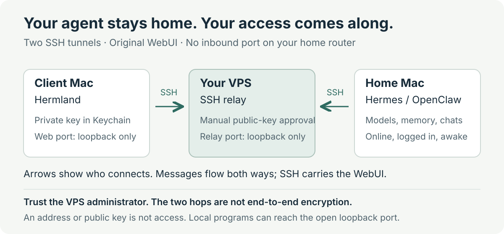

# Hermland

[English](README.en.md) · [简体中文](README.md)

**Use your own Hermes or OpenClaw from another Mac.** Your models, memory, and conversations stay on the original always-on Mac. No migration, and no public WebUI endpoint.

[Download notarized beta](https://github.com/ALVIN-YANG/Hermland/releases/tag/v0.2.0) · [Website and setup flow](https://alvin-yang.github.io/Hermland/?lang=en) · [Quick start (Chinese)](docs/快速开始.md)

macOS 14+ · Universal Apple Silicon / Intel build · MIT. Version 0.2.0 is Developer ID–signed and Apple-notarized. It remains a beta; independent-user and Intel hardware acceptance are still pending.

<p align="center">
  <a href="assets/readme/panorama.png"></a>
</p>

*The Chinese illustration shows concepts, not a product screenshot. It separates the operations; the updated app groups setup material, public keys, and checks into the three steps below.*

## What you can do

- **Keep using your existing agent.** Hermland displays Hermes WebUI or OpenClaw Control UI. It does not create another model configuration, memory store, or chat backend.
- **Allow only authorized computers.** Each device has its own key pair. Private keys stay in the local macOS Keychain. An administrator approves public keys manually, and the client verifies the pinned server key. There is no shared Gate token or automatic approval.
- **Ask your existing agent to help with setup.** Copy the public key, fingerprint, and instructions together. Export a toolkit if needed. Each step has a pass criterion; a manual guide is also included.
- **See which checks pass or fail.** Check configuration, device keys, SSH, and backend health separately, then copy a redacted report. A healthy endpoint does not prove that you are logged in or that the model can answer.
- **Revoke one computer.** The administrator lists, authorizes, and revokes public keys from the command line. Revocation closes that device's active connections and blocks reconnection without changing the agent or other devices.

For users who already run Hermes with WebUI, or OpenClaw Gateway with Control UI. You need a macOS 14+ client, an always-on Mac that stays online and awake, and your own Debian/Ubuntu VPS. Hermland is not hosted agent infrastructure or remote desktop software.

## Get started

1. **Prepare a server.** Select your existing backend and click “开始连接” (start connecting). Enter your own VPS address and SSH port. If you do not have one, follow the preparation guide. You or your administrator must first verify its identity and be able to manage it.
2. **Send a connection card.** Click “复制连接卡” (copy connection card), then paste it into your usual agent conversation. Check the device name and public-key fingerprint before explicitly approving authorization. Copying is not approval. Use the manual path if your agent cannot execute commands.
3. **Import and use.** Click “我收到连接文件了” (I have the connection file). Review the returned JSON and server fingerprint, then confirm its trusted source to start checks. Complete the original web login and send a message yourself to test the model.

These labels describe 0.2.0. For later devices, choose the welcome page's add-device link: only add a key, without reinstalling services or creating another home tunnel. You can import an existing JSON directly. For daily use, open the app; it reconnects using the saved configuration.

See the **[quick start guide (Chinese)](docs/快速开始.md)** for setup instructions, administrator commands, and pass criteria. Reuse working services and tunnels. Do not reinstall the agent, change models, or copy conversations. The app UI and detailed guides currently use Chinese.

## How access is controlled



SSH carries traffic; it does not create the web page. Both Macs initiate connections to your VPS. The original Hermes/OpenClaw at home still serves the page shown in the app. No inbound port on the home router or domain name is required. Arrows show connection initiation; messages flow both ways.

A public key is an identifier you can share; its matching private key stays on your Mac. Once an administrator registers the public key, SSH verifies possession of that private key. Knowing an IP, public key, or connection JSON does not grant access. The app also pins the server public key supplied by the administrator. Device accounts can forward only to the assigned port and cannot execute shell commands.

Two SSH tunnels **do not provide end-to-end encryption between the client and the always-on Mac**: you must trust the VPS administrator. Other programs on the client computer can also access its open loopback port. OpenClaw's original login and device authentication remain in place. The tools stop on unsupported wildcard rules, address conditions, or potentially overlapping SSH policies; they do not rewrite other services to make setup succeed.

[Relay architecture (Chinese)](docs/远程中转.md) · [Authorize and revoke devices (Chinese)](docs/安全门禁.md) · [Security boundaries and private reports (Chinese)](SECURITY.md)

## Before daily use

- **Keep the home Mac online, logged in, and awake.** User-login services cannot run while it is asleep or logged out; Hermland cannot wake an offline Mac.
- **Green checks are not a full acceptance test.** They send no model requests. Verify web login and a real response yourself. Hermland needs no Screen Recording or Accessibility permission; an agent's desktop tools may need them separately.
- **Revoke only the lost computer.** Use trusted administrator SSH from the Mini or another management Mac. Revocation closes that device's connections, not conversations or other devices. Management is currently command-line only.

## Why not just use Tailscale / a VPN?

Hermland is a dedicated entrance to **one agent WebUI, not a general-purpose private network**. This path reuses your VPS and macOS SSH, without another VPN client or hosted mesh account. Each computer gets access to one relay port, with manually sent keys, explicit approval, and visible checks.

That is not a claim of stronger security. Tailscale also supports [administrator device approval](https://tailscale.com/docs/features/access-control/device-management/device-approval) and [device, protocol, and port restrictions](https://tailscale.com/docs/features/access-control/grants). Its WireGuard traffic stays end-to-end encrypted even through [DERP relays](https://tailscale.com/docs/reference/derp-servers), which cannot decrypt it. Our SSH hops meet at the VPS, so its administrator must be trusted.

The tradeoff: you maintain a VPS, SSH, and the home Mac. **First setup is not guaranteed to be easier than Tailscale.** If you already use Tailscale, need NAS/desktop access to several services, or require relays that cannot decrypt traffic, keep it with appropriate approval and access rules. This version does not inspect or change your VPN and has no Tailscale connection mode.

Still choosing a route? Compare [six remote-access options](docs/外网连接方案对比.en.md): dual SSH, Tailscale, self-hosted WireGuard, Cloudflare Tunnel + Access, direct SSH, and frp. Compare maintenance and trust boundaries; connectivity is not authorization.

## Get the app

No App Store is needed. [Download the notarized 0.2.0 beta](https://github.com/ALVIN-YANG/Hermland/releases/tag/v0.2.0), choose `Hermland-0.2.0.zip`, unzip it, move the app to Applications, and open it. The toolkit is bundled; `HermlandSetup-0.2.0.zip` is an optional toolkit, not another app. Checksums and build provenance are attached to the release.

Developer ID signing, Hardened Runtime, secure timestamps, Apple notarization, stapling, and Gatekeeper checks on the extracted final ZIP passed for 0.2.0. A normal first-launch confirmation is expected. If macOS still reports an unverified developer, verify the source, version, and checksum and report it; do not bypass the warning. [Apple's safe-launch guidance](https://support.apple.com/en-us/102445).

Beta describes pending independent-user, Intel hardware, and broader cross-network testing, not an unsigned package. The old [0.1.0-preview.1](https://github.com/ALVIN-YANG/Hermland/releases/tag/v0.1.0-preview.1) `-dev.zip` remains unnotarized; choose the new package. Never disable Gatekeeper or run protection-removal scripts. A website is only a download entrance.

An update may prompt for Keychain access. Verify Hermland and handle the prompt yourself; do not delete the existing device key. To build from source, use full Xcode, XcodeGen, and Python 3.9+:

```bash
git clone https://github.com/ALVIN-YANG/Hermland.git
cd Hermland/macos
xcodegen generate
xcodebuild -project Hermland.xcodeproj -scheme Hermland -configuration Debug \
  -destination 'platform=macOS' -derivedDataPath .build build
open .build/Build/Products/Debug/Hermland.app
```

[GitHub CI](https://github.com/ALVIN-YANG/Hermland/actions/workflows/ci.yml) covers secret scanning, Python checks, real SSH authorization and revocation on Ubuntu/Debian, macOS tests, and universal Intel/Apple Silicon development packages. CI artifacts are not notarized and are not official releases.

The OpenClaw integration acceptance script targets version 2026.9.9. Other upstream versions still need real verification. An iOS 17+ client is now being implemented and tested in `ios/`; **it has not been submitted for review or made available for download**. See the [iOS development and acceptance notes (Chinese)](ios/README.md). There is no Windows client, official one-line download installer, or server purchasing service. See the [release and acceptance checklist (Chinese)](docs/发布与验收.md) for signing, notarization, and independent cross-network installation tests.

## Contribute

Run `bash scripts/check.sh --macos` from the repository root. Container-based SSH checks, development packaging, and contribution rules are in [CONTRIBUTING (Chinese)](CONTRIBUTING.md). Never run the isolated-container test script directly on a real VPS. Use the app's redacted diagnostic report for issues; do not upload keys, tokens, or conversations.

Project code and original assets use the [MIT License](LICENSE). Upstream projects retain their own licenses.
