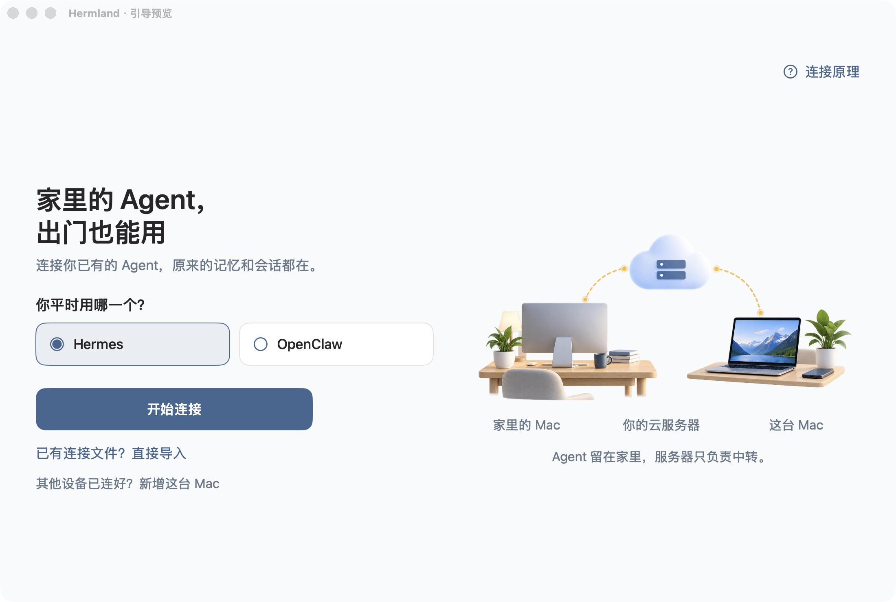

# Hermland

[English](README.en.md) · [简体中文](README.md)

**Your Hermes / OpenClaw stays home. Take access with you.** Open Hermland on another Mac and keep using your existing agent. Models, memory, and conversations stay in place, without exposing the agent’s web interface to the internet.

[Download for Mac](https://github.com/ALVIN-YANG/Hermland/releases/download/v0.2.1/Hermland-0.2.1.zip) · [Website](https://alvin-yang.github.io/Hermland/?lang=en) · [Full setup guide (Chinese)](docs/快速开始.md)

0.2.1 Beta · macOS 14+ · Universal Apple Silicon / Intel · Signed and Apple-notarized · Free, MIT open source



*Native welcome-screen preview. See the [website](https://alvin-yang.github.io/Hermland/?lang=en#setup) for the updated server and connection-card screens. Hermland is a connection tool, not another agent or a remote desktop. The app and detailed manual guides currently use Chinese; button labels below match the app.*

## What you need

- **A home Mac running your agent.** Existing Hermes + WebUI, or OpenClaw Gateway + Control UI. Keep it online, logged in, and awake. Do not send model API keys to Hermland.
- **Your own cloud server (VPS) to relay connections.** Debian / Ubuntu, managed by you or a trusted administrator. No domain name or inbound port on your home router is required.
- **Another Mac to run Hermland.** macOS 14 or later. Install only this app here, not another copy of your agent.

**No VPS yet?** You rent and maintain it yourself, paying the cloud provider. Use the [server preparation guide (Chinese)](docs/准备中转服务器.md) to get its public IP and SSH port and establish a verified administrator login first. Initial setup needs administrator access; entering an IP does not provision a hosted service.

## Your first connection

### 1. Enter your server

On the Mac you take with you, select your existing Hermes / OpenClaw and click “开始连接” (start connecting). Enter the VPS address and SSH port. Confirm that you or your administrator has verified the server’s identity and can log in.

The server should now be ready. **Entering an address does not install software or prove connectivity.** If you have no server, choose “还没有” (not yet) for preparation instructions.

### 2. Send a connection card to your existing agent

Click “复制连接卡” (copy connection card). Paste and send it in the conversation where you already talk to Hermes / OpenClaw. It contains setup instructions, this Mac’s public key, and its fingerprint, not a private key or password.

With execution tools, the agent can help configure the relay. Otherwise, you or your administrator uses “查看手动方式” (manual setup). **Check the reported device name and key fingerprint before explicitly approving access.** The fingerprint is the `SHA256:…` identifier shown in the app; both must match. First setup also requires checking the home Mac’s relay key. Reuse working services; do not reinstall the agent, change models, or move conversations.

The result: your agent or administrator returns a **`.json` connection file**. Copying or sending the card is not authorization by itself.

### 3. Import the file and connect

Save the file on this Mac. Click “我收到连接文件了” (I have the connection file), select it, check its trusted source and server fingerprint, then click “来源可信，连接并检查” (trust this source, connect and check). Canceling does not replace the existing configuration.

After the four checks pass, complete the original web login and send a message. **Setup is complete when your original chats are visible and the agent answers.** Health checks send no model messages. OpenClaw keeps its original Gateway login and device authentication.

[Prefer manual setup? Commands and pass criteria (Chinese)](docs/快速开始.md)

## After setup

- **Everyday use:** open Hermland. It reconnects with the saved configuration. Keep the home Mac and VPS online.
- **Another computer:** choose “其他设备已连好？新增这台 Mac” (add this Mac). Authorize only its new public key; do not redeploy the server. You can import an existing connection file directly. Never copy the old private key to a new Mac.
- **A lost computer:** an administrator [revokes that device’s key](docs/安全门禁.md#撤销一台电脑). Active connections close and reconnection is blocked, without affecting other devices or chats. Management is currently command-line only.

## A new route, not a new home for your agent


SSH carries traffic. Your home agent still serves the page shown in the app. Both Macs initiate connections to the VPS, so your home router needs no inbound port.

Each computer has its own keys; the private key stays in local Keychain. An administrator registers only public keys you explicitly approve, and the app pins the server key. **Knowing an IP, public key, or connection file does not grant access:** the device must prove possession of its approved private key. Device accounts can forward only to the assigned port, not execute shell commands.

The boundary matters: **trust the VPS administrator. Two SSH hops are not end-to-end encryption between the Macs.** Keep your agent’s original login enabled. Other local programs can access the local port opened by the app. There is no public authorization-request endpoint or automatic approval.

[Relay details (Chinese)](docs/远程中转.md) · [Authorize and revoke devices (Chinese)](docs/安全门禁.md) · [Security boundaries and reports (Chinese)](SECURITY.md)

### Why not just use Tailscale / a VPN?

Hermland focuses on one agent web interface, reusing your VPS and built-in Mac SSH without joining another VPN network. You maintain the server; first setup is not necessarily easier than Tailscale, nor is this a claim of stronger security. Tailscale also offers device approval and access restrictions, and its [DERP relays cannot decrypt end-to-end encrypted traffic](https://tailscale.com/docs/reference/derp-servers). Our VPS administrator must be trusted.

Already use Tailscale, or need several services such as a NAS and remote desktop? Keep it. Hermland does not change your VPN and currently has no Tailscale mode. See the [six-way remote-access comparison](docs/外网连接方案对比.en.md).

<details>
<summary>Expand the illustrated feature overview</summary>


This illustrated overview describes concepts. Follow the app and the steps above for actual setup.

</details>

## Get the app

[Download Hermland-0.2.1.zip](https://github.com/ALVIN-YANG/Hermland/releases/download/v0.2.1/Hermland-0.2.1.zip) → unzip → move to Applications → open. Quit the old version before upgrading. The toolkit is bundled; `HermlandSetup-0.2.1.zip` is an optional standalone toolkit, not a second app.

Developer ID signing, Apple notarization, stapling, and Gatekeeper checks on the extracted final ZIP passed for 0.2.1. Check the [release notes, SHA256, and build provenance](https://github.com/ALVIN-YANG/Hermland/releases/tag/v0.2.1). A normal first-launch confirmation is expected. Verify Hermland before handling Keychain prompts yourself; do not delete the device key. If macOS reports an unverified developer, check the source and version, then report it. **Do not disable Gatekeeper or run protection-removal scripts.** See [Apple’s safe-launch guidance](https://support.apple.com/en-us/102445).

**Still a beta:** independent first-time-user, Intel hardware, and broader cross-network acceptance are pending. No independent security audit is claimed. Old `-dev` packages are unnotarized; use the current package. OpenClaw integration acceptance targets 2026.9.9; other versions need verification. The iOS app is [in development and testing](ios/README.md), not submitted or available to download. No Windows client, server purchasing service, or official one-line installer is provided. See the [release and acceptance notes (Chinese)](docs/发布与验收.md).

<details>
<summary>Build from source and contribute</summary>

Requires full Xcode, XcodeGen, and Python 3.9+:

```bash
git clone https://github.com/ALVIN-YANG/Hermland.git
cd Hermland/macos
xcodegen generate
xcodebuild -project Hermland.xcodeproj -scheme Hermland -configuration Debug \
  -destination 'platform=macOS' -derivedDataPath .build build
open .build/Build/Products/Debug/Hermland.app
```

Run `bash scripts/check.sh --macos` from the repository root. See [CONTRIBUTING (Chinese)](CONTRIBUTING.md) for tests, isolated SSH acceptance, and packaging. Never run the isolated-container test script on a real VPS. CI artifacts are unnotarized and are not official releases.

Use redacted app reports for issues; do not upload keys, tokens, or chats. Project code and original assets use [MIT](LICENSE); upstream projects retain their own licenses.

</details>
