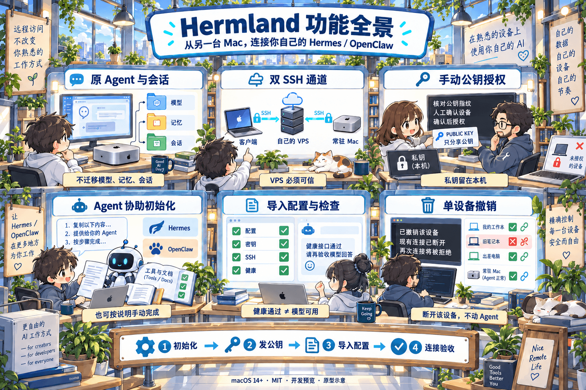
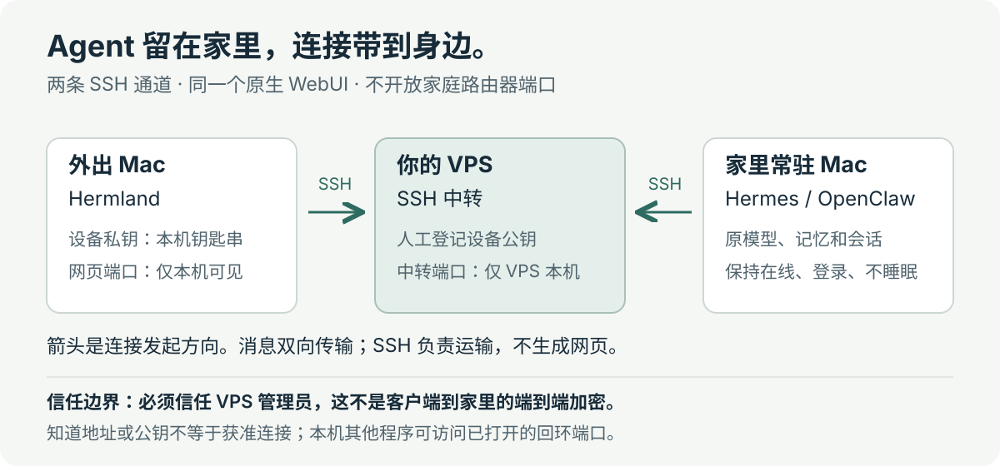

# Hermland

[简体中文](README.md) · [English](README.en.md)

**在另一台 Mac 上，继续使用你自己的 Hermes 或 OpenClaw。** 模型、记忆和会话仍在原来的常驻 Mac 上，不用迁移，也不用把 WebUI 暴露到公网。

A macOS SSH client for your existing Hermes or OpenClaw. Keep your agent where it is.

[下载已公证 Beta](https://github.com/ALVIN-YANG/Hermland/releases/tag/v0.2.0) · [官网与使用流程](https://alvin-yang.github.io/Hermland/) · [快速开始](docs/快速开始.md)

macOS 14+ · Apple Silicon / Intel 通用构建 · MIT。0.2.0 已 Developer ID 签名、Apple 公证；产品仍是 Beta，独立用户与 Intel 实机验收尚未完成。

<p align="center">
  <a href="assets/readme/panorama.png"></a>
</p>

*全景图是概念示意，不是产品截图。图中把操作展开展示；新版 App 将配置材料、公钥和检查合并成下面三步。*

## 你能用它做什么

- **接着用原来的 Agent。** 展示 Hermes WebUI 或 OpenClaw Control UI，不另建模型配置、记忆库或聊天后端。
- **只让授权电脑接入。** 每台电脑独立公钥，私钥留在本机钥匙串；管理员人工确认，客户端固定校验服务器身份。没有共享 Gate 令牌或自动审批。
- **让已有 Agent 协助配置。** 一次复制公钥、指纹和指令；可导出配置工具，每步有通过标准，也能手动完成。
- **看得见哪里通过、哪里失败。** 配置、密钥、SSH、后端健康逐项检查，可复制脱敏报告。健康通过不代表已登录或模型能回答。
- **单独撤销一台电脑。** 管理员用命令行列出、授权、撤销公钥；撤销会关闭该设备的现有连接并拒绝重连，不动其他设备和 Agent。

适合已经有 Hermes + WebUI 或 OpenClaw Gateway + Control UI 的用户。需要 macOS 14+ 客户端、一台在线且不睡眠的常驻 Mac，以及自己的 Debian/Ubuntu VPS。不是云托管 Agent，也不是远程桌面。

## 第一次怎么用

1. **准备服务器。** 选择已有的 Hermes / OpenClaw，点「开始连接」。填写自己的 VPS 地址和 SSH 端口；还没有服务器就按页面指引准备。先确认自己或管理员能够可信登录。
2. **发连接卡。** 点「复制连接卡」，回到原 Agent 对话粘贴发送。对方报告设备名和公钥指纹后，由你明确确认授权。不会执行命令的 Agent 改用页内的手动方式；复制不等于授权。
3. **导入并使用。** 点「我收到连接文件了」，核对返回的 JSON 来源与服务器指纹，确认后自动连接检查。完成原网页登录，再由你发消息验证回答。

以上为 0.2.0 的引导。**新增电脑**点欢迎页「其他设备已连好？新增这台 Mac」，只增加公钥授权，不重装服务或另建隧道。已有 JSON 可直接导入；**日常使用**只需打开 App，已保存的配置自动连接。

完整指令、管理员命令、每步通过标准见 **[快速开始](docs/快速开始.md)**。已有正确服务和隧道就复用，不重装 Agent，不改模型，不复制会话。

## 连接为什么可信



SSH 是运输通道，不是网页服务。家里的 Mac 主动连到 VPS，Hermland 也主动连到 VPS；App 中的网页仍由家里的 Hermes/OpenClaw 提供。家庭路由器不用开入站端口，也不需要域名。图中箭头表示连接发起方向，聊天消息双向传输。

公钥是可以发出的“钥匙编号”，私钥是本机保留的“钥匙”。管理员登记公钥后，SSH 验证客户端确实持有对应私钥；只知道 IP、公钥或连接 JSON 的人不能因此接入。App 同时固定校验管理员提供的服务器公钥，防止连错服务器。设备账户只能转发到指定端口，不能执行 Shell。

双 SSH **不是客户端到常驻 Mac 的端到端加密**，VPS 管理员必须可信；客户端本机的其他程序也能访问已打开的回环端口。OpenClaw 原有登录与设备身份仍保留。工具只支持可验证的 SSH 规则，遇到通配符、地址条件或可能重叠的账户策略会停止，不改其他服务来凑成功。

[中转原理](docs/远程中转.md) · [公钥授权与撤销](docs/安全门禁.md) · [安全边界与私密漏洞报告](SECURITY.md)

## 使用时最容易弄错什么

- **常驻机不能离线或睡眠。** 用户登录启动的服务需要保持登录、网络可用且不睡眠；关机后 App 无法替它唤醒。
- **四项绿色检查不等于全部可用。** 检查不发模型请求；网页登录、真实回答由你完成。Hermland 不需要屏幕录制或辅助功能，Agent 的桌面工具权限需另行设置。
- **只撤销丢失的那台电脑。** 在 Mini 或其他管理电脑通过可信管理员 SSH 撤销对应公钥，会关闭该设备连接；不删除聊天，不撤销其他设备。当前管理仍为命令行，没有管理 GUI。

## 为什么不直接用 Tailscale / VPN

我们做的是**一个 Agent 网页的专用入口，不是把几台电脑组成通用网络**。当前选择双 SSH，是为了复用自己的 VPS 和 macOS 自带 SSH、不额外安装 VPN 客户端或接入托管组网账号，并把每台电脑的权限固定在一个中转端口上。人工发送公钥、确认授权、逐项检查都在这条窄流程里。

这不是“比 Tailscale 更安全”的结论。Tailscale 同样支持[管理员批准设备](https://tailscale.com/docs/features/access-control/device-management/device-approval)和[按设备、协议、端口限制访问](https://tailscale.com/docs/features/access-control/grants)，不是加入后就只能全网互通。它的 WireGuard 流量在经过 [DERP 中转](https://tailscale.com/docs/reference/derp-servers)时仍端到端加密，中转不能解密；我们的双 SSH 在 VPS 汇合，必须信任 VPS 管理员。

代价也明确：Hermland 需要你维护 VPS、SSH 和常驻机，**不保证比 Tailscale 更容易首次安装**。已有 Tailscale、希望连 NAS/远程桌面等多个服务，或不希望中转能接触明文时，可以继续用 Tailscale 并配置好审批和访问规则，不必为本项目拆掉它。此版本不读取、不修改已有 VPN，也没有 Tailscale 接入模式。

还在选择外网访问方式？看[六种方案对比](docs/外网连接方案对比.md)：双 SSH、Tailscale、自建 WireGuard、Cloudflare Tunnel + Access、直接 SSH、frp。按维护成本和信任边界选择，不把“能连通”当成“已授权”。

## 获取 App

无需 App Store。[下载 0.2.0 已公证 Beta](https://github.com/ALVIN-YANG/Hermland/releases/tag/v0.2.0)，选择 `Hermland-0.2.0.zip`，解压后把 App 移到「应用程序」，再打开。配置工具已内置；`HermlandSetup-0.2.0.zip` 是可选独立工具包，不是另一个 App。Release 附 SHA256 校验值与构建来源。

0.2.0 的 Developer ID 签名、Hardened Runtime、安全时间戳、Apple 公证、票据附加和最终 ZIP 解包后的 Gatekeeper 检查均通过。首次“是否打开”属于正常系统确认；若仍出现“无法验证开发者”，先核对本仓库下载来源、版本和校验值并报告问题，不绕过保护。[苹果的安全启动说明](https://support.apple.com/zh-cn/102445)。

Beta 表示产品仍待独立用户、Intel 实机和更多跨网络验收，不表示未签名。旧 [0.1.0-preview.1](https://github.com/ALVIN-YANG/Hermland/releases/tag/v0.1.0-preview.1) 的 `-dev.zip` 仍未公证，请选新版。不全局关闭 Gatekeeper，不运行去除保护的脚本；官网只是下载入口。

升级可能弹出钥匙串访问确认，请核对 Hermland 后自行处理，不删除原设备密钥。源码构建需要完整 Xcode、XcodeGen 和 Python 3.9+：

```bash
git clone https://github.com/ALVIN-YANG/Hermland.git
cd Hermland/macos
xcodegen generate
xcodebuild -project Hermland.xcodeproj -scheme Hermland -configuration Debug \
  -destination 'platform=macOS' -derivedDataPath .build build
open .build/Build/Products/Debug/Hermland.app
```

[GitHub CI](https://github.com/ALVIN-YANG/Hermland/actions/workflows/ci.yml) 覆盖秘密扫描、Python 检查、Ubuntu/Debian 真 SSH 授权与撤销、macOS 测试和 Intel/Apple Silicon 通用开发包。CI artifact 未公证，不等同于正式发行。

OpenClaw 集成验收脚本对应 2026.9.9，其他上游版本仍需实际验收。iOS 17+ 客户端已进入实现与验收阶段，源码位于 `ios/`，**尚未提交审核或开放下载**；见 [iOS 开发与验收](ios/README.md)。当前没有 Windows 客户端、官方“一行下载”安装器或服务器购买服务。正式签名、公证和独立用户跨网络验收见 [发布与验收](docs/发布与验收.md)。

## 参与开发

在项目根目录执行 `bash scripts/check.sh --macos`；真实 SSH 容器检查、开发打包与贡献约定见 [CONTRIBUTING](CONTRIBUTING.md)。不要在真实 VPS 上运行隔离容器测试脚本。问题反馈使用 App 的脱敏检查报告，不上传密钥、令牌或聊天记录。

项目代码与自有素材采用 [MIT](LICENSE)，上游软件保留各自许可证。
