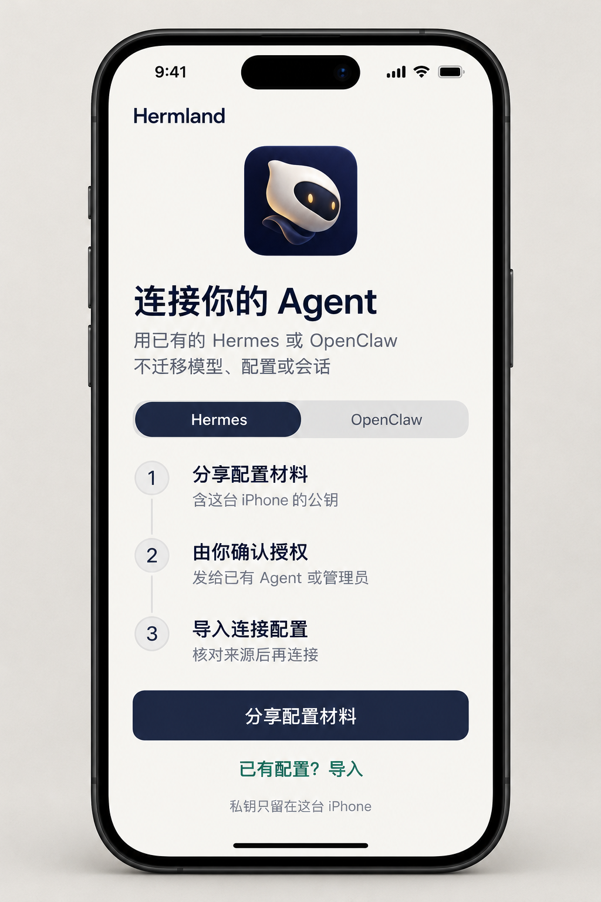
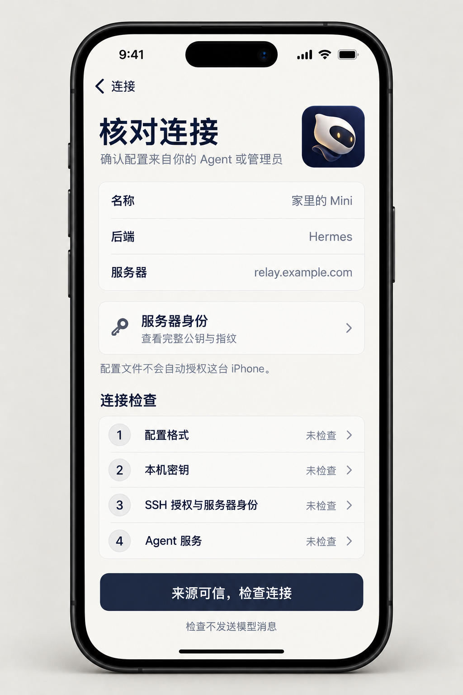
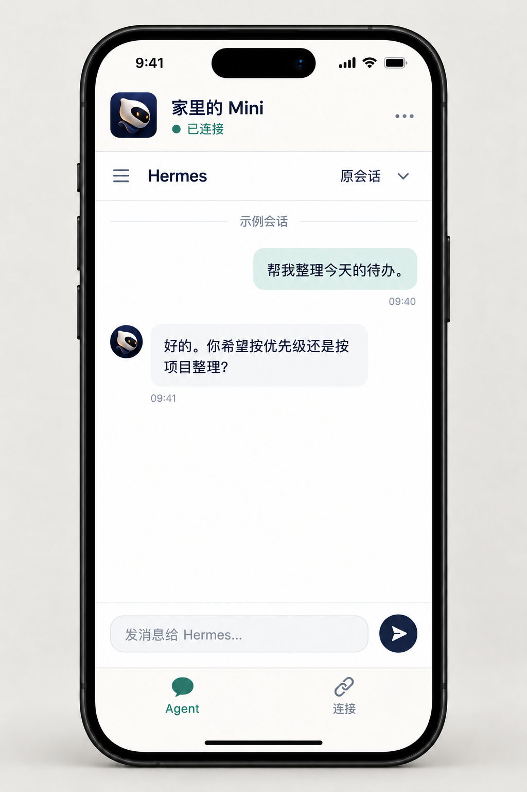
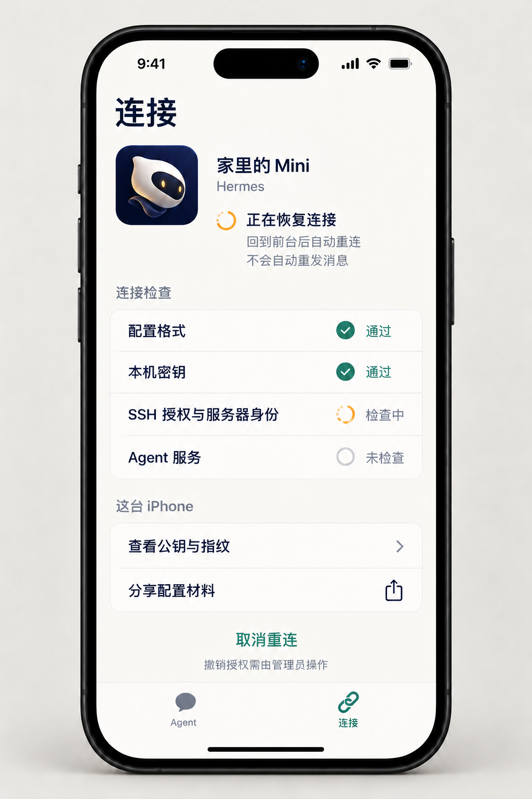

# Hermland iOS：连接方案与界面设计

本文保留 2026-10-13 的方案与概念设计记录，以下图片不是商店截图。后续已开始原生 iOS 实现，当前事实、构建方法与待验收项以 [iOS 开发与验收](../ios/README.md) 为准；尚未提交审核。Mac Mini 的首次打开验收仍是独立待办，不与 iOS 完成状态混淆。

## 结论

可以开发 iOS 版。首版推荐「原生连接工具 + 原 Agent 的移动网页」：手机独立持有设备密钥，沿用现有 VPS 和常驻 Mac 的双 SSH，不新建账号系统、VPN、公开连接申请或云端聊天代理。

适合打开手机查看会话、发送短消息、在需要时访问家里的 Agent。是否好用仍取决于原网页的手机布局、登录和断线行为，必须分别实测 Hermes 与 OpenClaw。首版不承诺锁屏后连接常驻、后台实时回复或任务完成推送。

## 最小连接形态

```text
iPhone
原生配置 / 本机身份 / 连接状态
          │
WKWebView → 127.0.0.1 本机端口
          │ 应用内 SSH；固定校验 VPS 公钥
          ▼
自有 VPS：每台设备独立、仅转发专用账户
          │ 仅 VPS 回环中转端口
          ▼
常驻 Mac 已有反向 SSH
          │
原 Hermes WebUI / OpenClaw Control UI
原模型、凭据、记忆与会话
```

这是复用现有系统的建议，不是已跑通的 iPhone 链路。

现有 Mac 客户端通过 `Process` 调用系统 `ssh-keygen` 和 `ssh`。iOS 不能照搬子进程方案，需在 App 内处理密钥和 SSH。候选是 Apple 的 [SwiftNIO SSH](https://github.com/apple/swift-nio-ssh) 与 [NIO Transport Services](https://github.com/apple/swift-nio-transport-services)：前者提供公钥认证与 TCP 转发的协议基础，后者使用 Network.framework，支持 iOS。它们是开发组件，不是直接可用的成品客户端；本次未添加依赖或确定版本。[Apple 对 iOS 子进程限制的说明](https://developer.apple.com/forums/thread/747499)。

| 边界 | 责任与失败处理 |
| --- | --- |
| 手机身份 | 在本机生成独立 Ed25519 密钥，建议使用仅本设备、解锁时可读的钥匙串策略；不导出、同步或复制 Mac 私钥。丢失手机由管理员撤销，换手机重新授权。不能声称 Ed25519 密钥存入 Secure Enclave。 |
| 连接配置 | 复用现有 JSON 字段和验证规则。公钥材料只经用户手动分享；导入时先显示服务器与完整公钥/指纹。格式有效不证明来源可信。 |
| SSH 通道 | 对端公钥必须与可信配置一致，只尝试本机公钥认证，只转发已授权的 VPS 回环端口。不请求 Shell、终端、远程管理或其他转发权限。 |
| Agent 页面 | 用隔离于其他连接的 WebView 数据存储打开原网页，保留原 Gateway 登录/设备校验。外部链接不替换可信 Agent 页面。原网页登录失败不误报为 SSH 失败。 |
| 连接生命周期 | 前台按需连接。回到前台先复查原路由、重新认证与探测，再恢复原页面；失败展示原因，不循环刷服务器或自动修改后端。 |

VPS 管理员属于可信边界。双 SSH 是两段加密，中转处能接触内容，**不是 iPhone 到 Mini 的端到端加密**。手机本机回环也不是身份认证边界；不能把“只监听 127.0.0.1”说成“只有本 App 能访问”。这些边界沿用现有 [安全说明](../SECURITY.md)，不因手机图标或原生界面而改变。

## 用户流程

初次接入仍是三步：

1. 在手机选择已有 Hermes 或 OpenClaw，分享配置材料：本机公钥、指纹与初始化说明。手动发给已在使用的 Agent 或可信管理员。
2. 管理员核对机器和指纹，经用户明确确认后只授权该 iPhone。已有中转正常时不安装、升级或修改它。
3. 导入管理员返回的 JSON，核对来源、服务器与指纹，再运行四项检查。之后在原网页完成登录，由用户单独发送消息验证模型回答。

日常打开 → 自动连接 → 使用原会话。不要求每天重发公钥。手机不会把配置材料自动送到 VPS，也没有“申请连接”入口。

「取消重连 / 断开」只停止手机当前连接，不撤销服务器授权；丢失设备或永久停用仍由管理员通过原有工具撤销对应设备，不能只删手机里的配置。SSH 通过、健康接口通过、网页登录与模型回答须分别报告。

## 独立 iPhone UI

只保留两个日常入口：**Agent**、**连接**。初次配置用导航栈，不提前出现空的聊天首页。需要更多内容时滚动、展开详情或用系统分享面板，不把桌面的参数面板缩进手机。

使用象牙白、深墨蓝和克制的青绿色；橙色仅表示恢复中。四张图使用同一手机框、排版、导航与现有「轻盈信使」图标。正式 App 的图标源直接复用 [现有 1024px 图标](../artwork/icons/hermland-icon-messenger-1024.png)，不重新画鸟或新标志。生成图里的图标仅为视觉参考，不作为新的 AppIcon 源。

以下均为 AI 生成概念图，**不是已实现的 iOS 截图**。示例域名与会话不是生产数据；图 03 的网页内容仅说明空间分配，真实布局、头像、输入框和能力由所连接的原 Agent 页面决定，不通过注入脚本改变上游认证。

| 页面 | 主要动作 | 可验证结果 |
| --- | --- | --- |
| 01 初次配置 | 分享材料或导入已有配置 | 分享内容有本机公钥和指纹，无私钥、管理凭据或模型令牌。 |
| 02 核对连接 | 看完整公钥/指纹，确认来源后检查 | 未确认前不发起连接；四项检查未执行时不能显示通过。 |
| 03 原会话 | 原网页中查看、发送消息 | 原登录保留；不另造 Hermes/OpenClaw 会话或模型。 |
| 04 前台恢复 | 查看检查状态，取消重连 | SSH 未通过时不标记 Agent 可用；不自动重发消息。 |

### 01 初次配置



### 02 核对连接



### 03 原会话



### 04 前台恢复



## 不能承诺的后台行为

iOS 通常会挂起进入后台的 App；不能用循环保活、播放无声音乐或无关后台权限来维持 SSH。首版按「前台连接、后台可中断、返回重连」设计。[Apple 后台执行说明](https://developer.apple.com/documentation/xcode/configuring-background-execution-modes)。

重连只恢复连接和已有会话，**不重发 POST、消息或工具命令**。发送后断线而结果未知时保留“状态待确认”，先查看原会话；没有请求幂等或服务端去重证据，不自动补发。

手机后台后，原 Agent 的任务是否继续，取决于上游断连语义。Hermes 和 OpenClaw 须各自验证，不能笼统写“任务在家里继续，不受手机影响”。未经用户明确同意，不在现有会话发送测试任务。

## 开发前最小验证

下一步应是隔离测试环境中的真机连接验证，而不是先做完整聊天客户端。需另行获得实施及依赖引入批准；模型消息测试、测试设备登记和服务器公钥授权也各按原审批边界执行。

| 必验项 | 通过证据 |
| --- | --- |
| 真机 SSH | 自有测试 VPS，iPhone 独立 Ed25519 身份，固定服务器公钥，TCP 转发和仅本机回环监听实际通过。 |
| 拒绝与撤销 | 未授权密钥、错误主机公钥均失败；撤销该手机时其旧连接关闭、重连被拒，其他设备不中断。 |
| 两种后端 | 分别确认原网页手机布局、键盘、登录、会话与 WebSocket/SSE；不能用一张 Hermes 图证明 OpenClaw 可用。 |
| 网络恢复 | Wi-Fi / 蜂窝切换、断网、锁屏后返回；无重复消息、无自动 POST 重试、无凭据串用。 |
| 原环境隔离 | 不改已有 Hermes/OpenClaw 的配置、模型、会话或服务进程；本轮默认不用生产环境完成上述破坏性/消息测试。 |

不把模拟器截图当作真机链路证据。通过最小验证且 UI 获得确认后，再确定最低 iOS 版本、依赖版本和正式实现范围；如果原网页的移动布局不合格，先报告具体问题，再决定是否需要单独的原生会话适配，不默认扩大到重写整个聊天协议。

## 如何交付普通 iPhone 用户

建议真机内部测试 → TestFlight 外部 Beta → App Store。官网下载页可以链接 TestFlight 或商店，不采用 Mac 的 Developer ID ZIP 路径作为普通 iPhone 安装方式。[Apple 发布路径](https://developer.apple.com/documentation/xcode/distributing-your-app-for-beta-testing-and-releases)、[TestFlight](https://developer.apple.com/testflight/)。

App Store 是否接受尚未验证。4.2 要求足够的原生实用价值，不能只包装网页；4.2.7/4.7 对部分远程薄客户端与聊天软件的规则也需在提交时按实际行为核对，不能凭“用了原生 SSH”保证审核通过。本方案不传输 Mini 桌面画面，不把它伪装成远程桌面 App。审核需要可用的专用演示环境，不提供家中生产访问、真实用户聊天或管理私钥。[App Review Guidelines](https://developer.apple.com/app-store/review/guidelines/)。

本次只完成方案与四张设计稿，没有创建 App Store 记录、上传构建、引入依赖、授权新设备或开发 iOS 代码。Mac Mini 浏览器下载/首次打开仍待验收。

出图模式：内置图像生成；完整提示词与两次导航统一修订见 [生成提示词](../artwork/ios/v1/生成提示词.md)。
